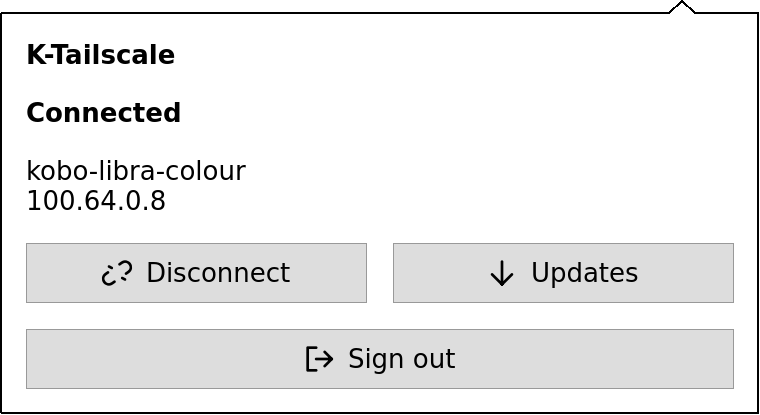
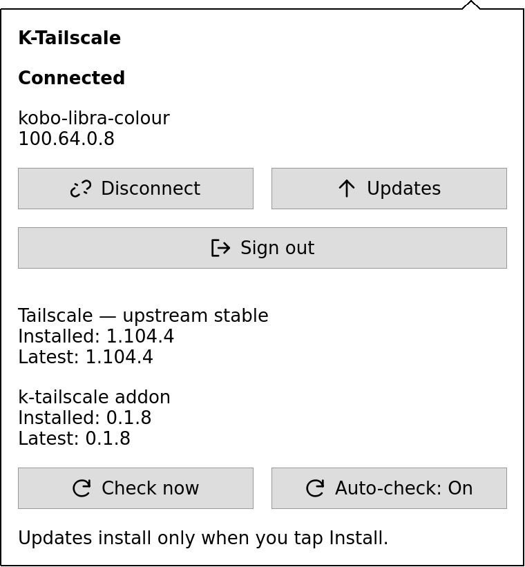

# k-tailscale

Tailscale on Kobo Libra Colour and Clara HD, with a native toolbar widget for connecting, signing in and installing updates. Inspired by [Relio](https://github.com/andronedev/relio).

**Supported device/firmware pairs:**

| Device | Model | Firmware |
| --- | --- | --- |
| Kobo Libra Colour | 390 | **4.46.23852** |
| Kobo Clara HD | 376 | **4.38.23852** |

The native addon targets Qt 5.2.1 and ARMv7 hard float. Other devices, firmware and cross-paired versions are refused by both the browser installer and on-device setup. NickelMenu is optional. Clara HD also needs the bundled TUN module for kernel `4.1.15-00136-g12655eaaef89`; it is verified and loaded automatically from RAM. Libra Colour uses its built-in TUN driver.

| Connection controls | Software updates |
| --- | --- |
| [](installer/images/widget-connected.png) | [](installer/images/widget-updates.png) |

Native UI previews with example device details. Select either image to view it at full size.

## Install

Use the [guided installer](https://clisboa.github.io/k-tailscale/) in Chrome or Edge, or download `KoboRoot.tgz` from [Releases](https://github.com/clisboa/k-tailscale/releases/latest).

1. Connect the Kobo by USB and tap **Connect** on its screen.
2. Select its `KOBOeReader` drive in the installer and choose **Install k-tailscale**. For a manual install, copy `KoboRoot.tgz` into the drive's hidden `.kobo` folder.
3. Safely eject the drive, unplug, and let the Kobo restart. Wait for **Preparing Tailscale** to finish.
4. Open the nine-dot icon beside Search and tap **Sign in** or **Connect**. Scan the sign-in QR with your phone, or open the complete text link on your phone or computer.

Use one installer at a time. An existing `.kobo/KoboRoot.tgz` is a pending update: finish or resolve it before installing this addon. The browser checks model/firmware, download SHA256 and copied-file SHA256. It preserves uncertain failed writes for inspection; browser APIs cannot exclude simultaneous writers in desktop applications. It does not automatically eject the drive or upload books/device credentials.

The complete package includes a signature-verified official stable Tailscale release and the helper. The same storage layout serves both models: public Tailscale binaries live on books storage, while verified executable copies run from private RAM. Identity, preferences and trusted hashes remain on system storage. Tailscale 1.104.4 uses about **67 MiB of RAM** for those copies; setup and updates temporarily use more RAM. Setup checks available RAM, tmpfs and disk space, retaining a 64 MiB memory reserve and 16 MiB disk reserve. It never falls back to running unverified public files. A new install asks you to sign in; an existing recognized installation preserves its identity and connection preference. Unknown/custom layouts are retained and reported.

When upgrading from the original books-storage installation, use its old **Stop for USB** once before step 1. Subsequent USB transfers need no stop button. The original onboard copy is retained for recovery but never copied over current root state again.

## Use and updates

- Tap the nine-dot toolbar icon to open **K-Tailscale**, a compact dropdown. The connected icon fills five dots in a **T**. Tap the icon again or tap outside to dismiss.
- **Sign in** explicitly requests interactive authentication, including when an old node key remains, and shows its QR and fallback link. **Connect** resumes a saved login; **Disconnect / Cancel** control the connection. The widget keeps the Kobo's reported name and shows its Tailscale IP only while connected. Status refreshes automatically. Disconnect retains the running daemon for status queries.
- **Sign out** ends the current login after an inline confirmation. **Cancel** or tapping outside leaves you signed in. After signing out, tap **Sign in** to obtain a fresh QR and fallback link; Disconnect keeps your login.
- Wi-Fi detection recognizes registered wireless interfaces, including the Clara's older `eth0` naming, and checks its active default route. Ethernet and Tailscale interfaces alone do not count as Wi-Fi.
- Connection controls wait for verified RAM preparation and service readiness, with progress messages before the sign-in QR appears. Real startup failures and connection warnings remain visible.
- Clara HD's kernel has no Netfilter support. Its endpoint connection uses Tailscale's `--netfilter-mode=off`; Libra Colour retains its existing firewall setting. The addon does not configure subnet routing or exit-node service. See [Tailscale's netfilter modes](https://tailscale.com/docs/reference/netfilter-modes).
- Setup selects the default name for the model: `kobo-libra-colour` or `kobo-clara-hd`. Connection actions use the generated system-storage script, without reading the books partition. The widget displays the hostname reported by Tailscale.
- Sign in uses a 15-second CLI wait for completing authentication; this is a timeout, not a delay before the QR. The QR appears as soon as Tailscale provides its URL and stays usable while you finish on your phone. Without a current link, a failed attempt shows its real diagnostic instead of a preparation acknowledgement. Normal saved-login Connect retains its 90-second connection timeout.
- When sign-in is required, a QR code opens the current login URL on your phone. The complete text URL stays visible; long links that cannot form a readable QR use text alone. QR generation runs locally in memory.
- Library sync works with a server reachable through your tailnet, such as BookOrbit or Calibre-Web. Configure that service separately.
- **Updates** expands below the connection controls and shows two independent channels. Tailscale follows the latest **official upstream stable** release directly. The toolbar addon follows this project's signed releases.
- Checks run automatically while the UI is visible and Wi-Fi is available, at most once every six hours, with a 30-minute retry after an unsuccessful check. **Check now** bypasses that interval. Checks never install software or turn Wi-Fi on.
- Tap **Install Tailscale update** or **Install addon update** explicitly. Installation requires Wi-Fi and at least 20% battery or charging. Addon updates require an explicit **Restart Kobo** afterward.

Tailscale updates verify official distribution signatures, validate both ARM executables in private RAM and preflight disk and memory space. The helper checkpoints quiescent state, swaps the complete executable directory, then checks the new daemon's LocalAPI/version. A failed start restores the previous pair and immutable state checkpoint. Disconnected preference is preserved. An intentionally stopped daemon stays stopped; its new version is validated on the next start. Durable journals recover interrupted activation or rollback.

Addon updates use an independent Ed25519 public key, a signed size/hash/version manifest and an exact file whitelist. Updates write only the addon's own system files; they never replace the runtime's Tailscale binaries or identity. Interrupted file replacement restores immutable backups. The current core helper stays active until successful setup after a restart promotes the new version.

Public upstream downloads and complete binary releases live in `.adds/k-tailscale/store` on books storage. Active executables run from `/tmp/k-tailscale-runtime/bin`; private identity and recovery checkpoints stay under `/usr/local/tailscale-runtime`. Each RAM refill checks both files against system-protected SHA256 hashes; installation and updates also verify official Tailscale distribution signatures before executing either file. Do not delete the public store: it supplies the next boot's RAM copies. Clara's optional 34 KiB TUN module and its license live in `.adds/k-tailscale/kernel/clara-hd`; the helper verifies its RAM copy before normal kernel loading. No kernel image is installed.

USB transfers need no stop button. A small wrapper around the supported firmware's USB script blocks new public-file operations, cancels active addon public I/O and waits for handles to close before exporting the drive. It preserves and verifies the original script and refuses unknown customizations. The RAM daemon can keep running; Nickel normally turns Wi-Fi off during USB, and the saved connection preference applies when Wi-Fi returns. Update checks and connection controls use only system storage and RAM. A cold start or update that needs books storage waits until it is mounted again.

## Recovery and removal

An error appears in the panel with **Retry setup** when preparation fails. The closed report `.adds/tailscale-ui/migration-status.txt` is readable over USB. Active logs use private RAM storage under `/tmp/kobo-tailscale/`; private daemon state stays in `/usr/local/tailscale-runtime/state/`. Never share that state directory.

The plugin renames itself to `libtailscaleui.so.failsafe` for its first 20 seconds. If Nickel crashes before restoration, the toolbar remains disabled on the next boot. Reinstall the complete USB archive to retry. You can also create `.adds/tailscale-ui/disable-plugin` over USB and restart to disable the toolbar, then delete that marker and restart to re-enable it.

To remove the toolbar, copy `KoboRoot-uninstall.tgz` to `.kobo/KoboRoot.tgz`, safely eject and unplug. Removal retains Tailscale, its active boot helpers, identity and library configuration. The independent core helper is retained because the runtime needs it. Onboard documentation/reports may remain.

A killed connection/update action can leave a lock in RAM. Restart before retrying. An unexpected/custom system layout is refused rather than overwritten. System storage needs room for private state checkpoints and small addon files, with a 16 MiB reserve. Books storage holds the public previous and candidate releases; RAM must hold the active pair and the candidate during an update. Low memory or space is reported before activation. Failed updates restore the previous pair and private identity checkpoint; a recovery journal survives power loss.

## Build and validation

A Linux Docker daemon, Go matching `helper/go.mod`, Node.js 24+, Python 3 and OpenSSL with Ed25519 support are required. Qt native tests need Qt 5 development packages, make, a C++11 compiler, procps, coreutils and zbar-tools (independent QR decoding). `tests/Dockerfile` supplies native dependencies. NickelTC GCC/Qt 5.2.1 is pinned in `scripts/Dockerfile`.

```sh
go -C helper test -race ./...
go -C helper vet ./...
make test
python3 -m unittest discover -s tests -p 'test_*.py' -v
node --test installer/*.test.mjs
scripts/build.sh
scripts/build-helper.sh
scripts/build-tun.sh
mkdir -p build/upstream
build/k-tailscale-helper-host fetch-release --directory "$PWD/build/upstream" > build/upstream/artifact.json
python3 scripts/package.py
python3 scripts/verify-package.py dist/KoboRoot.tgz
python3 scripts/verify-package.py --kind update dist/k-tailscale-update.tgz
python3 scripts/verify-package.py --kind remove dist/KoboRoot-uninstall.tgz
python3 scripts/build-site.py
```

Archives have deterministic metadata, fixed ownership/modes and SHA256 sums. Tests cover native UI/processes, Unix sockets, signature verification, archive scope, installation, power-loss recovery and identity retention. Version 0.1.9 has been checked on both supported device/firmware pairs: Clara setup and QR sign-in, Libra migration with its existing login retained, connection controls and native BookOrbit sync. Both devices' runtime reports confirm verified RAM execution, working Wi-Fi and TUN, and zero daemon references to books storage during the USB check. The Libra's upstream update check also passed. Native previews use Qt 5.15; the production build targets Qt 5.2.1.

Version0.1.8 is the first public release at `clisboa/k-tailscale`. Earlier local builds through0.1.7 use a different addon-feed URL and need this complete USB installer once to adopt the public release feed.

The updater embeds a Mozilla TLS CA bundle so release checks and downloads work even when the Kobo system CA store is missing or outdated. Both release feeds share this trust store, while normal HTTPS hostname and expiry checks remain enabled. The CA snapshot is refreshed in addon releases independently of Tailscale binary updates; see `helper/ca/README.md` for provenance.

Tailscale's distribution-signature verification library and public signing-root bundle are pinned to v1.104.4. The latest upstream stable software remains independently downloadable; a future incompatible signing protocol/root rollover requires an addon update. The optional Clara TUN module is GPLv2; every release containing it includes its complete corresponding source and reproducible recipe in `k-tailscale-tun-source.tar.gz`. See [kernel/README.md](kernel/README.md). See [RELEASING.md](RELEASING.md) for publishing/signing and [NOTICE](NOTICE) for attribution and licenses. This is an independent project, unaffiliated with Kobo or Tailscale.
